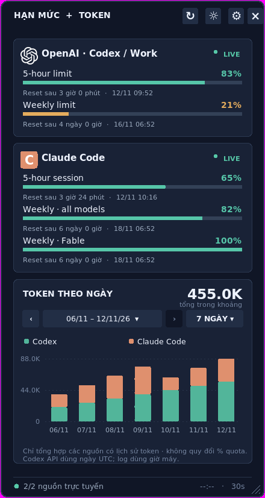
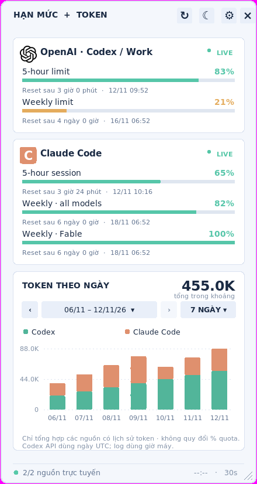

# AI Limit Desk

**Widget desktop cho Windows giúp theo dõi hạn mức sử dụng và lịch sử token của các công cụ AI trong một cửa sổ nhỏ gọn.**

AI Limit Desk dành cho người dùng thường xuyên làm việc với **OpenAI Codex** và **Claude Code**, muốn xem nhanh quota còn lại, thời điểm reset và lượng token đã dùng mà không phải mở từng công cụ. Ứng dụng cũng hỗ trợ bật thêm **Antigravity** và bổ sung dữ liệu từ file JSON.

Dự án được viết bằng **Python và Tkinter**.

## Giao diện

| Chế độ tối | Chế độ sáng |
| --- | --- |
|  |  |

Ảnh sử dụng dữ liệu minh họa để kiểm tra giao diện, không phải số liệu tài khoản thật. Ứng dụng không có chế độ demo.

## Tính năng

- **Theo dõi quota:** hiển thị phần trăm còn lại và thời điểm reset theo cửa sổ hạn mức, chẳng hạn 5 giờ, hằng tuần hoặc theo model, tùy dữ liệu dịch vụ trả về.
- **Tổng hợp nhiều dịch vụ:** mặc định hiển thị Codex và Claude Code; có thể bật Antigravity hoặc ẩn các dịch vụ không sử dụng.
- **Lịch sử token:** biểu đồ cột chồng theo dịch vụ, có mốc 7 / 14 / 30 ngày, duyệt các giai đoạn hoặc chọn khoảng ngày trong lịch sử 90 ngày khi có dữ liệu.
- **Widget linh hoạt:** kéo để di chuyển, thay đổi kích thước từ mép hoặc góc cửa sổ, tùy chọn luôn nổi trên cùng.
- **Tùy chỉnh giao diện:** chế độ sáng/tối, độ hiển thị từ 55% đến 100%, lưu vị trí và kích thước cửa sổ.
- **Tự cập nhật:** mặc định mỗi 30 giây, có thể chọn 60 / 90 / 120 / 300 giây; hỗ trợ làm mới thủ công bằng `Ctrl+R`. Riêng Claude Code được kiểm tra thưa hơn, tối thiểu 3 phút/lần, vì endpoint quota của Anthropic giới hạn tần suất rất chặt.
- **Khởi động cùng Windows:** bật/tắt trong phần cài đặt.
- **Dữ liệu bổ sung:** đọc quota và token theo ngày từ `custom_usage.json`.

## Nguồn dữ liệu

| Dịch vụ | Quota | Lịch sử token |
| --- | --- | --- |
| OpenAI Codex | Đọc qua `codex app-server` bằng phiên CLI đã đăng nhập | Dữ liệu tài khoản nếu được hỗ trợ; nếu không, đọc log phiên cục bộ |
| Claude Code | Đọc qua endpoint usage của Anthropic bằng phiên OAuth CLI có sẵn | Đọc log phiên cục bộ |
| Antigravity | Đọc từ language server cục bộ khi IDE đang chạy | Chưa hỗ trợ nguồn lịch sử token đáng tin cậy |
| Dịch vụ tùy chỉnh | Đọc từ file JSON do người dùng cung cấp | Đọc trường `daily_tokens` trong JSON |

Widget không quy đổi phần trăm quota thành số token. Tổng token trên biểu đồ chỉ bao gồm các dịch vụ đang hiển thị và có nguồn lịch sử token.

## Yêu cầu

- Windows 10/11.
- Python 3.10 trở lên, có Tkinter và được thêm vào `PATH`.
- Kết nối Internet để cài thư viện và cập nhật dữ liệu dịch vụ qua mạng.
- Đã đăng nhập công cụ cần theo dõi trên chính máy Windows:
  - **Codex:** cài Codex CLI và đăng nhập bằng tài khoản ChatGPT. API key không cung cấp quota thuê bao cho luồng kiểm tra này.
  - **Claude Code:** đăng nhập bằng OAuth qua `/login`, với file thông tin đăng nhập CLI có thể đọc được.
  - **Antigravity:** mở IDE và bật dịch vụ trong phần cài đặt widget.

Chỉ đăng nhập trên trình duyệt có thể chưa đủ để ứng dụng phát hiện tài khoản.

## Cài đặt và chạy

1. Tải hoặc sao chép mã nguồn vào một thư mục cố định.
2. Chạy `start_windows.bat`.
3. Script tự tạo môi trường `.venv`, cài các thư viện trong `requirements.txt` và mở widget.
4. Mở biểu tượng **⚙** để chọn dịch vụ, giao diện, chu kỳ cập nhật và tùy chọn khởi động cùng Windows.

Nếu muốn chạy thủ công, mở PowerShell tại thư mục dự án:

```powershell
python -m venv .venv
.\.venv\Scripts\python.exe -m pip install -r requirements.txt
.\.venv\Scripts\python.exe main.py
```

## Sử dụng nhanh

- Kéo phần đầu cửa sổ để di chuyển widget.
- Kéo mép hoặc góc cửa sổ để đổi kích thước; góc dưới bên phải có vạch chéo để dễ thao tác.
- Nhấp đúp góc dưới bên phải để trở về kích thước mặc định và tự điều chỉnh chiều cao.
- Dùng các nút trên biểu đồ để chọn số ngày, lùi/tiến giai đoạn hoặc chọn khoảng ngày cụ thể.
- Nhấn `Ctrl+R` để làm mới dữ liệu.

Chiều rộng tối thiểu là 390 px. Chiều cao tối thiểu phụ thuộc nội dung quota và biểu đồ; với màn hình nhỏ, có thể ẩn bớt dịch vụ trong cài đặt.

## Cấu hình và quyền riêng tư

Dữ liệu ứng dụng được lưu tại `%LOCALAPPDATA%\AI_Limit_Desk\`:

| Tệp/thư mục | Nội dung |
| --- | --- |
| `settings.json` | Tùy chọn giao diện, dịch vụ, vị trí và kích thước widget |
| `cache.json` | Dữ liệu quota và token đã lấy được |
| `custom_usage.json` | Dữ liệu dịch vụ bổ sung do người dùng cung cấp |
| `logos/` | Bộ nhớ đệm logo dịch vụ |

Để thêm nguồn dữ liệu tùy chỉnh, tham khảo [file JSON mẫu](examples/custom_usage.example.json) và điền dữ liệu thực vào `custom_usage.json` tại thư mục trên. Không đưa mật khẩu, token đăng nhập hoặc cookie vào file này.

Ứng dụng không đọc cookie hay mật khẩu trình duyệt và không gửi dữ liệu tới máy chủ riêng của AI Limit Desk. Phiên OAuth Claude Code có sẵn được dùng để truy vấn quota trực tiếp từ Anthropic; widget không lưu hoặc ghi log thông tin xác thực. Một số logo dịch vụ được tải qua mạng, còn logo OpenAI được đóng gói sẵn.

## Giới hạn hiện tại

- Khả năng lấy quota phụ thuộc phiên đăng nhập, loại tài khoản và giao thức của từng dịch vụ. Các endpoint nội bộ có thể thay đổi.
- Khi lần cập nhật mới thất bại, số liệu cũ được giữ lại và đánh dấu **CŨ**, kèm tuổi dữ liệu và lý do lỗi thật, ví dụ `Cũ 9 phút trước · Bị giới hạn tần suất (HTTP 429) · thử lại sau 5 phút`.
- Nếu Claude trả về HTTP 429, widget tạm dừng gọi Claude 5 phút, rồi 10, 20, 30 phút nếu vẫn bị chặn (dùng `Retry-After` khi server cung cấp, tối đa 1 giờ) và tự khôi phục khi gọi thành công. `↻`/`Ctrl+R` vẫn làm mới các dịch vụ khác nhưng không gọi Claude trong thời gian tạm dừng.
- Lịch sử token cục bộ phụ thuộc các log có trên máy và có thể khác báo cáo thanh toán chính thức.
- Antigravity cần IDE đang chạy và chưa có thống kê token lịch sử.
- Giao diện không có vùng cuộn; số lượng quota lớn có thể vượt không gian màn hình.

## Đóng gói EXE

Sau khi chạy `start_windows.bat` để chuẩn bị môi trường, chạy:

```powershell
.\build_exe_windows.bat
```

Script dùng PyInstaller để tạo file `dist\AI_Limit_Desk_V5.exe` trên Windows. Tên EXE và các file ảnh hiện giữ hậu tố `V5` theo cấu trúc mã nguồn; phiên bản được giới thiệu của dự án là **v1**. Cần tự chạy script để tạo EXE.

## Phát triển và kiểm tra

Các thư viện chính: `requests`, `psutil`, `Pillow`; giao diện sử dụng Tkinter đi kèm Python.

```powershell
# Chạy bộ kiểm thử
.\.venv\Scripts\python.exe -m unittest discover -s tests -v

# Chạy ứng dụng trong cửa sổ console để xem lỗi
.\debug_windows.bat
```

Cũng có thể chạy `run_tests.bat` để thực hiện bộ kiểm thử.

| Thành phần | Vai trò |
| --- | --- |
| `main.py` | Giao diện widget và điều phối cập nhật |
| `providers.py` | Lấy và chuẩn hóa quota từ các nguồn |
| `poll_policy.py` | Chu kỳ gọi riêng từng dịch vụ, backoff khi bị giới hạn tần suất, nội dung thẻ **CŨ** |
| `token_history.py` | Đọc, tổng hợp lịch sử token |
| `storage.py` | Lưu cấu hình, cache và thiết lập khởi động cùng Windows |
| `layout.py`, `resize.py`, `view_state.py` | Bố cục, đổi kích thước và trạng thái hiển thị |
| `logos.py`, `assets/` | Logo và tài nguyên giao diện |
| `tests/` | Bộ kiểm thử |

## Giấy phép

Mã nguồn được phát hành theo [MIT License](LICENSE). Logo và tên dịch vụ thuộc chủ sở hữu tương ứng; xem [ghi chú thương hiệu](assets/BRANDING.md). AI Limit Desk là dự án độc lập, không đại diện cho các nhà cung cấp dịch vụ AI.
